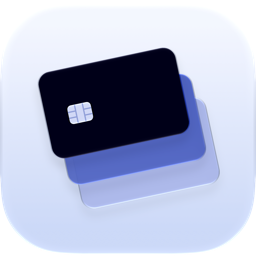
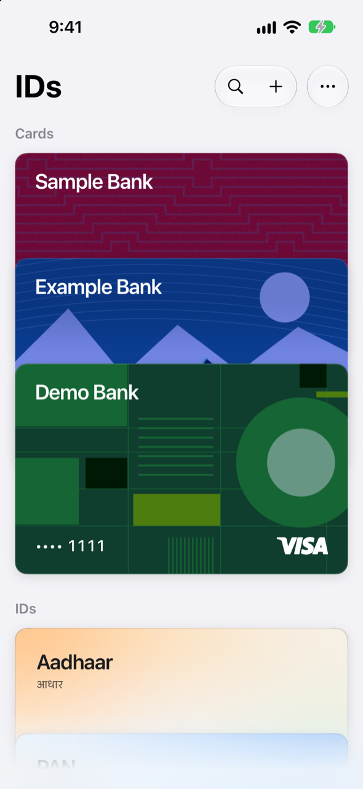
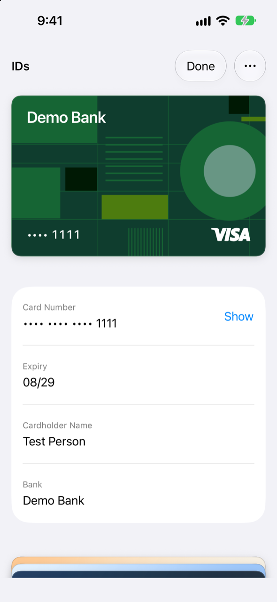
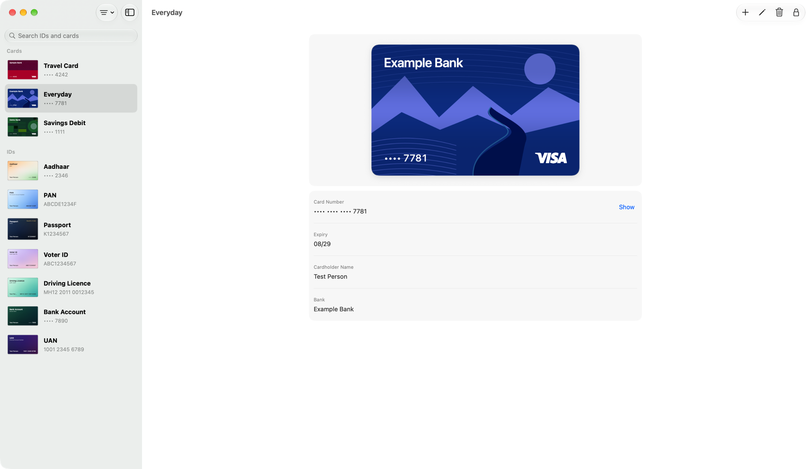

<p align="center">
  
</p>

<h1 align="center">Identité</h1>

<p align="center">
  Indian IDs and bank cards as copyable text, on iPhone and Mac.
</p>

<p align="center">
  
  
  
  
</p>

<p align="center">
  <a href="#on-iphone">iPhone</a> |
  <a href="#on-mac">Mac</a> |
  <a href="#install">Install</a> |
  <a href="#privacy">Privacy</a> |
  <a href="#development">Development</a>
</p>

## For Indian IDs

Forms ask for the same numbers every time: PAN, Aadhaar, passport, IFSC. Identité keeps them as text you copy in one tap, behind Face ID.

It holds Aadhaar, PAN, passport, voter ID, driving licence, UAN, bank accounts, and credit and debit cards, grouped by person. It checks each number as you type, can scan the card, and reminds you before anything expires.

## On iPhone

Cards stack like Apple Wallet. Tap one to bring it forward and copy any field. Numbers stay masked until you show them.

<p align="center">
  
  
</p>

Bank cards come in 37 designs: 30 from Cardy and 7 drawn for Identité. Each one takes its colours from the scanned card, a preset, or colours you pick.

## On Mac

The same IDs in a window and in the menu bar. Both lock after five minutes away, or straight away with Lock.

<p align="center">
  
</p>

## Install

| Platform | How |
| --- | --- |
| iPhone | [TestFlight](https://testflight.apple.com/join/BfXC6gb1) |
| Mac | [TestFlight](https://testflight.apple.com/join/BfXC6gb1), or the notarized app from [Releases](../../releases) |

## Supported IDs

| Group | ID | Checked with |
| --- | --- | --- |
| Identity | Aadhaar | 12 digits, Verhoeff checksum, Secure QR |
| | PAN | `AAAAA9999A` |
| | Passport | `A1234567`, MRZ check digits |
| | Voter ID | `AAA9999999` |
| | Driving licence | State code and number |
| Money | Credit and debit cards | Luhn check, network |
| | Bank account | Account number and IFSC |
| Work | UAN | 12 digits, PF member IDs |

## Privacy

IDs stay on your devices and sync through your private iCloud, where ID values, names and notes are stored as encrypted fields. Device backups follow your backup settings. There is no server, no analytics and no tracking.

- Face ID on iPhone. Touch ID, your password or Apple Watch on Mac.
- The app locks after five minutes away and shows a cover in the app switcher.
- Copies of ID values stay on this device and clear after 60 seconds (30 for a CVV) or on a normal quit. [Details](docs/privacy/index.md#clipboard).
- Card PINs are never stored. Each CVV reveal or copy asks for Face ID again.
- ID values are never logged.

Someone who gets past your device passcode can read your IDs. The passcode remains the main protection.

## Development

Requires Xcode 27 and [XcodeGen](https://github.com/yonaskolb/XcodeGen).

```bash
xcodegen generate
open IDHolder.xcodeproj
```

Run the checks before you commit.

```bash
swift test --package-path Packages/IDCore
xcodebuild test -project IDHolder.xcodeproj -scheme IDHolder-macOS -destination 'platform=macOS'
xcodebuild test -project IDHolder.xcodeproj -scheme IDHolder-iOS -destination 'platform=iOS Simulator,name=iPhone 17'
```

To build under your own team, change `DEVELOPMENT_TEAM`, the bundle ID and the iCloud container in `project.yml`.

| Path | Contents |
| --- | --- |
| `Packages/IDCore` | Models, validators, scanning parsers and card colour logic, with Swift Testing |
| `App/Shared` | SwiftUI views shared by both apps |
| `App/iOS`, `App/macOS` | Platform apps |
| `Tests`, `UITests` | Mac tests and iPhone UI tests |

<sub>Not affiliated with UIDAI, the Income Tax Department, any bank or any card network. Bank and network names and logos belong to their owners.</sub>

<sub>Card designs adapted from [Cardy](https://piqodesign.gumroad.com/l/cardy) by Piqo Design, used under [CC BY 4.0](https://creativecommons.org/licenses/by/4.0/). Colours and layout were changed for Identité.</sub>
